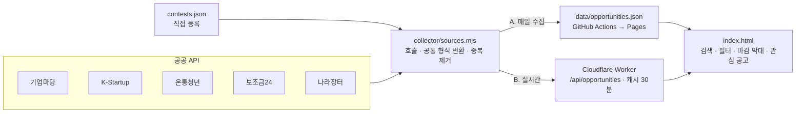

# 기회레이더

정부 지원사업, 창업 공고, 청년정책, 공공서비스(보조금), 공공입찰(용역), 공모전을 공공 API로 모아 **마감일 순으로** 보여 주는 검색 사이트입니다.
기업마당, K-Startup, 온통청년, 보조금24, 나라장터를 따로 돌아다니지 않고 한 화면에서 "지금 신청할 수 있는 것"을 찾는 것이 목표입니다.

- `index.html` 파일 하나로 동작합니다. 연결된 데이터가 없으면 예시 데이터로 화면을 보여 줍니다.
- 인증키는 브라우저에 두지 않습니다. 수집 스크립트(GitHub Actions)나 API 프록시(Cloudflare Worker)에만 넣습니다.

---

## 1. 누구를 위한 사이트인가

| 사용자 | 찾는 것 | 대표 출처 |
|---|---|---|
| 예비창업자·초기 창업자 | 사업화 자금, 액셀러레이팅, 경진대회 | K-Startup, 기업마당(창업) |
| 중소기업·소상공인 | 정책자금, 수출·판로, 스마트공장, 바우처 | 기업마당 |
| 청년 | 월세·일자리·교육 지원, 정책 공모 | 온통청년 |
| 개인·가구 | 기한이 있는 보조금과 혜택 | 보조금24 |
| 용역 수행 기업·기관 | 공공 용역 입찰 | 나라장터 |
| 학생·일반인 | 아이디어·영상·데이터 공모전, 해커톤 | 전 출처에서 키워드 추출 + 직접 등록 |

핵심 시나리오는 세 가지입니다.

1. **마감 확인**: 들어오자마자 "오늘 마감 / 7일 안에 마감" 숫자와 4주 마감 막대를 보고, 놓치면 안 되는 공고부터 연다.
2. **내 조건으로 거르기**: 대상(청년, 예비창업자, 소상공인 등)과 지역을 한 번 고르면 브라우저에 저장되어 다음 방문에도 그대로 적용된다.
3. **저장과 일정 등록**: 관심 공고에 별표를 하고, 마감일을 구글 캘린더에 바로 넣는다.

---

## 2. 데이터 출처 (공공 API)

| 출처 | 제공기관 | 담는 내용 | 엔드포인트 | 인증키 |
|---|---|---|---|---|
| 기업마당 지원사업정보 | 중소벤처기업부 | 금융·기술·인력·수출·내수·창업·경영 지원사업 공고 (약 1,400건) | `bizinfo.go.kr/uss/rss/bizinfoApi.do` | 기업마당에서 발급 (`crtfcKey`) |
| K-Startup 사업공고 | 창업진흥원 | 창업 지원사업 공고, 모집 중 여부 | `apis.data.go.kr/B552735/kisedKstartupService01/getAnnouncementInformation01` | 공공데이터포털 15125364 |
| 온통청년 청년정책 | 국무조정실·한국고용정보원 | 중앙·지자체 청년정책 (약 2,600건) | `youthcenter.go.kr/go/ythip/getPlcy` | 온통청년에서 발급 (`apiKeyNm`) |
| 대한민국 공공서비스(혜택) 정보 | 행정안전부 | 보조금24 서비스 (약 1만 1천 건, 기한 있는 것만 사용) | `api.odcloud.kr/api/gov24/v3/serviceList` | 공공데이터포털 15113968 |
| 나라장터 입찰공고정보 | 조달청 | 용역 입찰공고, 예산, 마감 일시 | `apis.data.go.kr/1230000/ad/BidPublicInfoService/...` | 공공데이터포털 15129394 |

공공데이터포털 키 하나(`DATA_GO_KR_API_KEY`)로 K-Startup, 보조금24, 나라장터를 함께 씁니다. 각 데이터셋에 활용신청은 따로 해야 합니다.

### 출처별로 알아 둘 점

- **기업마당**: 검색어 파라미터가 없어 전체(`pageUnit=1500`)를 받은 뒤 거릅니다. `pageIndex`를 빼면 오류가 납니다. 오류도 HTTP 200에 `{"reqErr": ...}`로 옵니다. 지역은 `hashtags`에 섞여 있고, 전국 공고는 17개 시도가 모두 들어 있습니다.
- **K-Startup**: 필터는 `cond[필드::EQ|LIKE]` 형식이어야 적용됩니다(`cond[rcrt_prgs_yn::EQ]=Y`). 날짜는 대부분 `YYYYMMDD`입니다.
- **온통청년**: 2025년에 새 API로 바뀌었습니다(옛 `openApiVlak` 방식은 종료). 상세 주소는 응답에 없어 `plcyNo`로 만듭니다. 연속 호출하면 403이 날 수 있어 1초 간격을 둡니다.
- **보조금24**: 대부분 "상시신청"이라 날짜가 있는 서비스는 5% 정도입니다. 검색어가 없으면 기한 있는 서비스만 남기고, `GOV24_INCLUDE_ALWAYS=true`면 전부 넣습니다.
- **나라장터**: 경로에 `/ad/`가 꼭 있어야 합니다. 키워드 검색은 `getBidPblancListInfoServcPPSSrch`에서만 되고, 조회 기간은 1개월 이내입니다. 용역 공고는 하루 수천 건이라 `G2B_KEYWORDS`로 관심 키워드를 정해 두는 편이 좋습니다.

### 공모전은 전용 공공 API가 없습니다

범정부 공모전 목록을 주는 공개 API는 찾지 못했습니다. 그래서 세 가지를 합칩니다.

1. 모든 출처의 제목에서 `공모전·경진대회·해커톤·챌린지·콘테스트·아이디어 공모`를 찾아 **공모전 유형을 추가로 붙입니다**. K-Startup의 `행사·네트워크` 분류가 특히 많이 걸립니다.
2. 운영자가 관리하는 **직접 등록 목록** `data/contests.json`을 합칩니다. 형식은 `data/contests.example.json`을 보세요.
3. (확장) 과학기술정보통신부 사업공고 API(공공데이터포털 15074634) 같은 부처별 공고 API를 출처로 더할 수 있습니다. 민간 공모전 사이트는 이용약관을 확인한 뒤 제휴나 직접 등록으로 다룹니다.

---

## 3. 구조



운영 방식은 둘 중 하나를 고르거나 함께 씁니다.

| | A. 매일 수집 (권장) | B. 실시간 프록시 |
|---|---|---|
| 동작 | GitHub Actions가 하루 한 번 모든 출처를 불러 JSON 파일을 만들고 Pages로 배포 | 사용자가 열 때 Worker가 API를 부르고 30분 캐시 |
| 비용 | 무료 (GitHub Pages) | 무료 한도 안에서 운영 가능 (Workers) |
| 장점 | 빠르고 호출 한도 걱정이 없음. 보조금24 1만 건도 모두 훑을 수 있음 | 검색어로 출처별 키워드 검색 가능, 최신성 |
| 한계 | 하루 1회 갱신 (대부분 출처가 원래 일 1회 갱신) | 요청당 호출 수 제한 때문에 페이지 수를 줄여 부름 |

화면은 먼저 실시간 프록시를, 다음으로 수집 파일을, 둘 다 없으면 예시 데이터를 씁니다(오른쪽 위 "데이터 연결"에서 바꿈). 프록시에 연결된 상태에서 검색창에 Enter를 누르면 출처별 키워드 검색 결과를 목록에 더합니다.

---

## 4. 공통 데이터 형식

수집기와 프록시는 출처가 달라도 아래 형식 하나로 돌려줍니다.

```json
{
  "generatedAt": "2026-10-17T20:50:00.000Z",
  "today": "2026-10-18",
  "sources": { "bizinfo": { "ok": true, "count": 1384 }, "youth": { "ok": false, "skipped": true, "error": "인증키 없음" } },
  "count": 2210,
  "items": [{
    "id": "kstartup:178662",
    "source": "kstartup",
    "title": "2026년 예비창업패키지 추가모집",
    "org": "창업진흥원",
    "category": "사업화",
    "target": "일반인 / 예비창업자",
    "region": "전국",
    "start": "2026-10-01",
    "end": "2026-10-20",
    "endTime": null,
    "periodText": "2026-10-01 ~ 2026-10-20",
    "always": false,
    "url": "https://www.k-startup.go.kr/...",
    "summary": "…",
    "amount": null,
    "tags": ["사업화", "예비창업자"],
    "postedAt": null,
    "alsoIn": ["bizinfo"]
  }]
}
```

- 날짜는 원문이 `20260803`, `2026-08-03 ~ ...`, `2026. 6. 15.(월)`처럼 제각각이라 한 가지 정규식으로 읽고, 날짜가 없으면 원문(`예산 소진 시까지` 등)을 `periodText`에 남깁니다.
- 기업마당과 K-Startup에 같은 공고가 함께 올라오는 경우가 많아 **제목(괄호·공백 제거) + 마감일**로 합치고, 다른 출처는 `alsoIn`에 적습니다.
- 연락처가 들어 있는 필드(기업마당 `refrncNm` 등)는 저장하지 않습니다.

화면은 이 형식에 다음 정보를 덧붙여 필터에 씁니다.

| 파생 정보 | 규칙 |
|---|---|
| 유형 | 출처별 기본 유형(지원사업·창업·청년정책·공공서비스·공공입찰) + 제목에 공모전 키워드가 있으면 `공모전` |
| 지원 대상 | 대상 원문과 제목에서 누구나·청년·학생·예비창업자·창업기업·중소기업·소상공인·기관·단체를 키워드로 찾음 |
| 분야 | 자금·금융, 기술·R&D, 인력·일자리, 수출·판로, 창업, 경영·컨설팅, 주거·생활, 복지·건강, 문화·홍보, 환경, 용역·입찰 |
| 지역 | 17개 시도 이름을 찾고, 없거나 전국이면 `전국`. 지역 필터는 전국 공고를 항상 함께 보여 줌 |
| 상태 | 오늘 기준으로 접수 예정 / 접수 중 / 7일 안에 마감 / 마감 / 상시 / 기간 확인 필요 |

---

## 5. 화면 구성

1. **머리말**: 이름, 데이터 연결 상태(예시 / 수집 시각 / 실시간)와 건수. 누르면 연결 설정 창.
2. **검색창**: 제목·기관·대상·개요·태그를 함께 찾고, 찾은 글자를 강조. `/` 키로 바로 이동. 자주 찾는 검색어 바로가기.
3. **마감 현황**: 오늘 마감, 7일 안에 마감, 접수 중, 접수 예정, 상시, 관심 공고 수. 누르면 그 상태로 걸러짐.
4. **4주 마감 막대**: 앞으로 28일 동안 날짜별 마감 건수. 3일 안은 빨강, 7일 안은 주황. 막대를 누르면 그날 마감 공고만.
5. **필터 레일**: 유형, 내 조건(대상·지역, 브라우저에 저장), 분야, 출처, 마감 포함 여부. 휴대폰에서는 접혀 있음.
6. **공고 목록**: D-day 칸 · 출처와 유형 · 제목 · 기관/지역/대상 · 접수 기간(입찰은 예산). 펼치면 개요와 상세 항목, 원문 보기, 구글 캘린더에 마감일 추가, 링크 복사.
7. **꼬리말**: 공공데이터 출처 표기와 "신청 전 원문 확인" 안내.

---

## 6. 실행 방법

### 화면만 보기

`index.html`을 브라우저로 열면 예시 데이터로 동작합니다. 수집 파일까지 읽으려면 로컬 서버로 엽니다.

```bash
cd opportunity-radar
npm run serve        # http://localhost:3000
```

### 공고 수집 (A 방식)

```bash
cd opportunity-radar
export BIZINFO_API_KEY=...      # 기업마당
export DATA_GO_KR_API_KEY=...   # 공공데이터포털 (K-Startup, 보조금24, 나라장터)
export YOUTH_API_KEY=...        # 온통청년
export G2B_KEYWORDS=플랫폼,홍보,교육   # 선택
npm run collect                 # → data/opportunities.json
npm test                        # 변환 규칙 테스트 (네트워크 없이)
```

키가 없는 출처는 건너뜁니다. GitHub Pages로 매일 자동 배포하려면 `deploy/github-pages.yml`을 저장소의 `.github/workflows/`로 복사하고, 파일 위쪽 안내대로 Secrets를 등록합니다.

### 실시간 프록시 (B 방식)

```bash
cd opportunity-radar/worker
npx wrangler secret put BIZINFO_API_KEY
npx wrangler secret put DATA_GO_KR_API_KEY
npx wrangler secret put YOUTH_API_KEY
npx wrangler deploy
```

배포된 주소(`https://opportunity-radar.<계정>.workers.dev`)를 화면의 "데이터 연결 → 실시간 API 프록시 주소"에 넣습니다. 운영할 때는 `wrangler.toml`의 `ALLOW_ORIGIN`을 사이트 주소로 좁히세요.

---

## 7. 단계별 계획

| 단계 | 내용 |
|---|---|
| 1. MVP (이 폴더) | 5개 공공 API 수집, 공통 형식, 검색·필터·마감 막대, 관심 공고, 캘린더 등록, 예시 모드 |
| 2. 알림 | 내 조건을 저장해 두면 새 공고와 마감 3일 전을 이메일·텔레그램으로 알림 (수집 결과를 전날과 비교) |
| 3. 맞춤도 | 업력·매출·나이·지역을 입력하면 공고별 "해당 가능성"을 표시. 공고문 첨부파일(PDF·HWP)에서 자격 요건 추출 |
| 4. 출처 확대 | 과기정통부·지자체 공고 API, 범부처 R&D(IRIS), 문화·예술 지원(아르코), 공모전 직접 등록 화면 |
| 5. 협업 | 팀이 함께 쓰는 관심 공고 보드, 신청 준비 체크리스트와 담당자 지정 |

---

## 8. 운영할 때 주의할 점

- **원문 확인**: 마감일과 자격 요건은 원문 공고가 기준입니다. 화면과 꼬리말에 계속 안내합니다.
- **이용 조건과 출처 표기**: 각 데이터는 제공기관의 이용허락 범위(공공누리 등)를 따르고, 출처를 표기합니다.
- **호출 한도**: 공공데이터포털 개발계정은 오퍼레이션별 하루 1,000~10,000회입니다. 매일 수집 방식이면 하루 수십 회로 충분합니다.
- **개인정보**: 담당자 이름·전화번호·이메일이 들어 있는 필드는 수집하지 않습니다. 관심 공고와 내 조건은 사용자 브라우저에만 저장합니다.
- **해외 IP**: 일부 정부 사이트는 해외 IP를 막을 수 있습니다. GitHub Actions(미국 러너)에서 실패하는 출처가 있으면 Cloudflare Worker(이용자 가까운 지역에서 호출)나 국내 서버에서 수집하세요.
- **명세 변경**: 응답 필드 이름은 오픈소스 프로젝트에 공개된 실제 응답을 기준으로 맞췄습니다. 키를 받은 뒤 `npm run collect` 결과의 출처별 건수와 오류를 한 번 확인하세요.

---

## 폴더 구성

```
opportunity-radar/
├── index.html                 # 화면 (파일 하나, 예시 데이터 내장)
├── collector/
│   ├── sources.mjs            # 출처별 호출 · 공통 형식 변환 · 중복 제거 (수집기와 프록시가 함께 사용)
│   ├── collect.mjs            # 수집 실행 → data/opportunities.json
│   └── sources.test.mjs       # 변환 규칙 테스트
├── worker/
│   ├── worker.mjs             # Cloudflare Worker 프록시
│   └── wrangler.toml
├── deploy/github-pages.yml    # 매일 수집 + Pages 배포 워크플로 예시
├── data/contests.example.json # 직접 등록 공모전 형식
└── package.json
```
